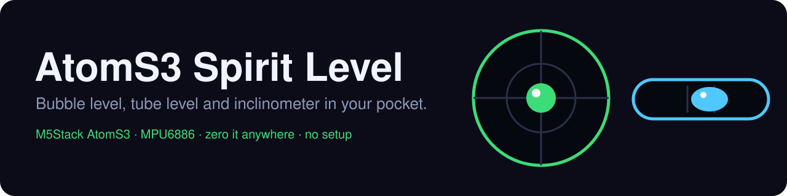
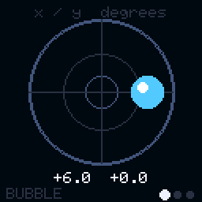
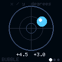
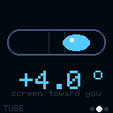
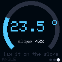
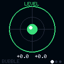
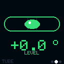
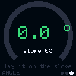

<p align="center">
  
</p>

<p align="center">
  <b>A pocket spirit level for the M5Stack AtomS3.</b><br>
  Bubble level &middot; tube level &middot; inclinometer &middot; zero it anywhere &middot; no Wi-Fi, no setup
</p>

<p align="center">
  <a href="https://electroiot.github.io/M5-AtomS3-Spirit-Level/flasher/"><b>Install in your browser</b></a> &middot;
  <a href="docs/FLASHING.md">Flashing guide</a> &middot;
  <a href="#modes">Modes</a> &middot;
  <a href="docs/HOW_IT_WORKS.md">How it works</a> &middot;
  <a href="docs/M5BURNER.md">M5Burner</a>
</p>

<p align="center">
  
</p>

## Modes

Click the screen to switch mode. The pictures are real frames from the AtomS3's own renderer; the
tilt shown was fed in with the `sim` serial command so each screen could be photographed.

| Bubble (flat on a table) | Tube (standing, for shelves and pictures) | Angle (slope / pitch) |
|:---:|:---:|:---:|
|  |  |  |
|  |  |  |

- **Bubble** - lay it screen-up. A 2-axis bubble runs to the high side and shows X / Y tilt in
  degrees. The ring turns **amber** within 2 deg and **green** within 0.5 deg (`LEVEL`).
- **Tube** - hold or stand it with the screen facing you and rest its edge on a shelf, picture
  frame or tile. A horizontal vial shows the angle in the screen plane.
- **Angle** - lay it on a ramp, roof or stair. Shows the slope in degrees and in percent.

## Buttons

| You do | It does |
|---|---|
| Click the screen | next mode |
| Hold 0.6 s, release | **zero** the current mode here (calibrate on a surface you know is level) |
| Hold 2.2 s, release | reset that mode's zero |

While you hold, the screen tells you what happens on release. Zero points are saved.

## Install

- **Browser (easiest):** open the [web installer](https://electroiot.github.io/M5-AtomS3-Spirit-Level/flasher/) in Chrome or Edge.
- **M5Burner:** search *AtomS3 Spirit Level* (device type ATOMS3).
- **esptool:** `esptool.py --chip esp32s3 --port COM9 write_flash 0x0 M5-AtomS3-Spirit-Level-v1.0.0-full.bin` from the [Releases](../../releases) page.
- **PlatformIO:** `git clone`, then `pio run -t upload`.

Details and download-mode tips: [docs/FLASHING.md](docs/FLASHING.md).

## Accuracy

It reads the built-in MPU6886 accelerometer, which is good to roughly half a degree out of the box.
**Zero it on a surface you trust** (a table you checked with a real level) for best results.
It is a handy pocket tool, not a calibrated instrument.

## Hardware

| | |
|---|---|
| Board | [M5Stack AtomS3](https://docs.m5stack.com/en/core/AtomS3) (ESP32-S3) - the version **with the display** |
| Sensor | MPU6886 accelerometer |
| Button | the screen itself |

Libraries: [M5Unified](https://github.com/m5stack/M5Unified) only.

## Test console

Serial console (115200): `ver`, `mode 0-2`, `zero`, `reset`, `sim ax ay az`, `sim off`, `shot`.
`tools/shot.py` uses it to take the README pictures. See [docs/HOW_IT_WORKS.md](docs/HOW_IT_WORKS.md).

Also for the AtomS3: [M5-AtomS3-Motion-Face](https://github.com/ElectroIoT/M5-AtomS3-Motion-Face).

## Repository

```
src/main.cpp        the whole firmware
platformio.ini      build config (m5stack-atoms3)
tools/shot.py       screenshots / GIF over USB
docs/               guides, images, screenshots, web installer (docs/flasher)
```

## License

MIT - see [LICENSE](LICENSE).
